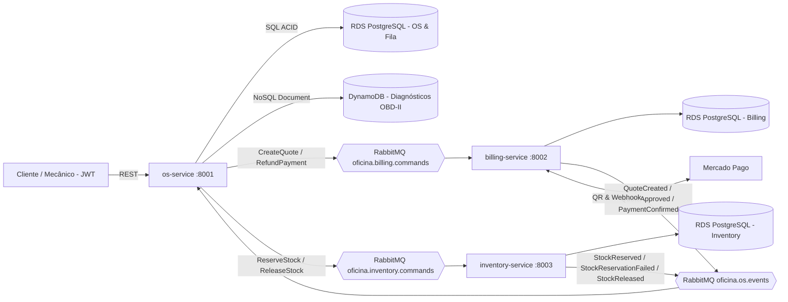

# Ordem de Serviço, Orquestração da Saga e Execução (`os-service`)

Microsserviço responsável pelo ciclo de vida das Ordens de Serviço (OS), pela **orquestração da Saga distribuída** (padrão *Transactional Outbox* + RabbitMQ) e pela **esteira de execução/produção da oficina** (`QUEUED -> DIAGNOSING -> REPAIRING -> COMPLETED`), incluindo persistência poliglota (**PostgreSQL** para transações de OS/Saga/Fila e **Amazon DynamoDB** para laudos e diagnósticos técnicos não estruturados).

---

## 1. Arquitetura do Ecossistema e Persistência Poliglota



### Justificativa da Divisão em 3 Microsserviços e Execução Integrada ao OS
- **`os-service` (Ordem de Serviço + Execução/Produção)**: A fila de atendimento e as etapas de diagnóstico, reparo e conclusão compartilham o mesmo agregado transacional da OS. Manter o módulo `execution` dentro do `os-service` evita saltos de rede síncronos para cada atualização de status de bancada e concentra a máquina de estados e auditoria em uma única fonte de verdade, enquanto **laudos e leituras de scanner OBD-II** (esquema variável por montadora/veículo) são gravados em **Amazon DynamoDB** (`app/diagnostics.py`).
- **`billing-service` (Orçamento e Pagamento)**: Isola regras financeiras, geração de QR Code dinâmico e recebimento de webhooks do **Mercado Pago**, protegendo dados de cobrança em banco próprio.
- **`inventory-service` (Estoque e Catálogo)**: Isola o controle concorrente de saldo de peças (`SELECT ... FOR UPDATE`) e precificação de catálogo.

---

## 2. Estratégia de comunicação e Saga

- **REST síncrono:** OS consulta o catálogo no Inventory para validar SKU e congelar nome/preço antes de criar a OS. Rotas internas autenticadas permanecem disponíveis como fallback de compatibilidade.
- **RabbitMQ assíncrono:** a outbox transacional da OS envia `CreateQuote`, `RefundPayment`, `ReserveStock` e `ReleaseStock` para filas duráveis. Billing e Inventory consomem somente os próprios comandos e publicam eventos de resultado em `oficina.os.events`.
- **Isolamento de dados:** cada serviço acessa exclusivamente seu próprio PostgreSQL. Integrações são feitas por contratos HTTP ou mensagens; nenhum serviço lê ou grava diretamente o banco de outro.
- As mensagens são persistentes, publicadas com confirmação do broker e envelopes JSON com `type`, `payload` e `correlation_id`. Mensagens que falham no consumidor são encaminhadas para a fila `.dlq` correspondente para inspeção e reprocessamento operacional.

### Por que Orquestração (e não Coreografia)?
1. **Visibilidade e Auditoria Centralizada**: O `os-service` mantém explicitamente o estado da Saga (`saga_state`) e o histórico (`order_history` e `outbox_messages`), evitando lógica de transição espalhada entre múltiplos serviços.
2. **Controle de Compensação Determinístico**: Em falhas pós-pagamento (falha de reserva de estoque ou cancelamento durante diagnóstico/reparo), o orquestrador dispara na ordem exata a liberação de peças (`ReleaseStock`) e a solicitação de estorno (`RefundPayment`).
3. **Prevenção de Acoplamento Cíclico**: `billing-service` e `inventory-service` não se conhecem; processam seus comandos e publicam eventos na fila compartilhada `oficina.os.events`.
4. **Resiliência (DLQ + Outbox)**: Comandos são persistidos na tabela `outbox_messages` na mesma transação local da OS e publicados pelo relay (`relay_outbox`). Cada fila durável possui uma fila de dead-letter (`.dlq`).

### Estados da Saga e Compensações

| Etapa | Comando emitido (Outbox -> RabbitMQ) | Evento consumido (`oficina.os.events`) | Estado da OS / Saga | Compensação em caso de falha |
|---|---|---|---|---|
| 1. Abertura | `CreateQuote` | `QuoteCreated` | `QUOTE_PENDING` -> `QUOTE_CREATED` | Retentativa via Outbox / `/retry-quote` |
| 2. Aprovação | — | `QuoteApproved` / `QuoteRejected` | `AWAITING_PAYMENT` / `CANCELLED` | `QuoteRejected` cancela a OS imediatamente |
| 3. Pagamento | — | `PaymentConfirmed` / `PaymentFailed` | `STOCK_RESERVING` / `CANCELLED` | `PaymentFailed` cancela a OS |
| 4. Estoque | `ReserveStock` | `StockReserved` / `StockReservationFailed` | `READY_FOR_SERVICE` (`COMPLETED`) | Em falha: `COMPENSATION_PENDING` -> emite `RefundPayment` -> `COMPENSATED` (`CANCELLED`) |
| 5. Execução | Fila interna (`/executions`) | Transições `QUEUED -> DIAGNOSING -> REPAIRING -> COMPLETED` | `IN_DIAGNOSIS -> IN_PROGRESS -> COMPLETED -> DELIVERED` | Cancelamento em oficina emite `ReleaseStock` + `RefundPayment` -> `COMPENSATED` (`CANCELLED`) |

---

## 3. Endpoints Principais e Especificação OpenAPI

A especificação completa está exportada em [`openapi.json`](./openapi.json) e disponível em `/docs` com o serviço em execução.

- `POST /orders` — Abre OS, valida catálogo e registra `CreateQuote` na Outbox.
- `GET /orders/{id}`, `GET /orders/{id}/history`, `GET /orders/{id}/outbox` — Consulta de status, histórico e mensagens da Saga.
- `POST /executions`, `GET /executions`, `POST /executions/next`, `PATCH /executions/{id}/status`, `POST /executions/{id}/complete` — Gestão da fila de produção, diagnóstico, reparo e conclusão.
- `POST /orders/{id}/diagnostics`, `GET /orders/{id}/diagnostics` — Registro e consulta de laudos técnicos em **Amazon DynamoDB**.
- `GET /health`, `GET /health/live`, `GET /metrics` — Probes Kubernetes e métricas de observabilidade (com propagação de `X-Correlation-ID` em HTTP e mensagens).

---

## 4. Execução Local, Testes, BDD e Cobertura

```bash
docker compose up --build
```

O compose deste workspace inicia os três serviços, seus bancos isolados e um RabbitMQ compartilhado. O workspace precisa conter os repositórios OS, Billing e Inventory ao lado deste repositório:

```powershell
docker compose -f docker-compose.yml -f docker-compose.microservices.yml up --build
```

Para executar a suíte de testes unitários + **BDD (`pytest-bdd`)** com verificação de cobertura mínima de 80%:

```bash
uv sync --dev
uv run pytest --cov=app --cov-report=term-missing --cov-report=xml --cov-fail-under=80
```

### Evidência de Cobertura de Testes (87% > 80% exigido)

```text
Name                   Stmts   Miss  Cover
------------------------------------------
app/__init__.py            0      0   100%
app/auth.py               26      0   100%
app/diagnostics.py        24      0   100%
app/main.py              548     89    84%
app/messaging.py          58      3    95%
app/observability.py      58      1    98%
------------------------------------------
TOTAL                    714     93    87%
25 passed (incluindo 2 cenários BDD em tests/features/order_saga.feature)
```

---

## 5. Infraestrutura (Terraform + Kubernetes) e CI/CD

- `infra/main.tf`: Provisiona instância **AWS RDS PostgreSQL 16**, broker privado **Amazon MQ for RabbitMQ** (TLS 5671) e tabela **Amazon DynamoDB** `oficina-os-diagnostics-<env>`. Grave o endpoint `rabbitmq_url` e as credenciais do broker no secret `microservices-secrets` (`rabbitmq-url`) consumido pelos três Deployments.
- `k8s/`: Manifestos `deployment.yaml`, `migration-job.yaml` e `datadog-agent.yaml` + `datadog-monitors.yaml`.
- `.github/workflows/ci-cd.yml`: Executa testes automatizados com gate de 80% de cobertura, análise estática no **SonarCloud**, validação Terraform (`fmt` + `validate`), build/push da imagem no GHCR e deploy automatizado no **Amazon EKS**.
